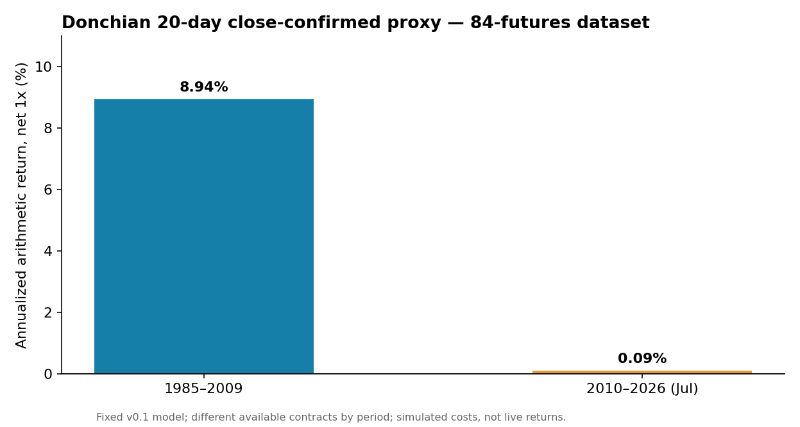
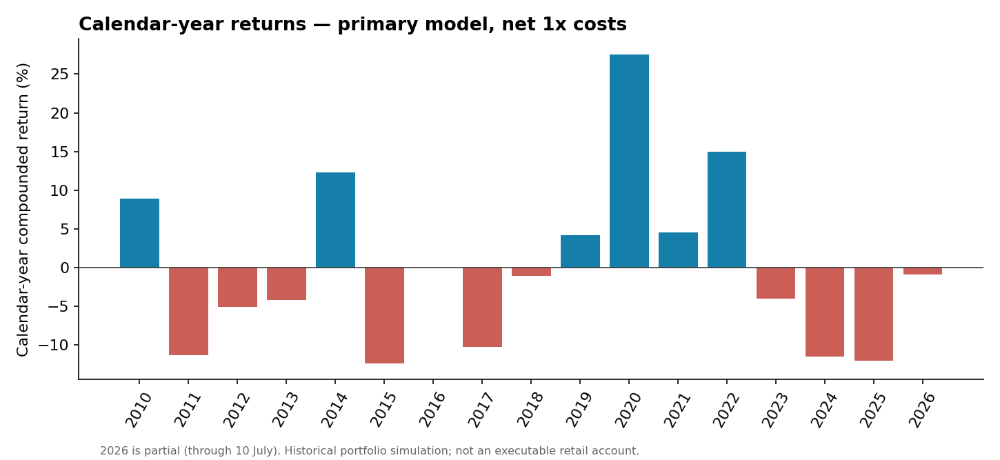

# Can a Classic Four-Week Breakout Still Make Money?

## Дончиан: можно ли заработать на 84 фьючерсных рынках?

**Закрытое исследование · 14 октября 2026 · Frozen v0.1 · Статус: FAIL / NOT VALIDATED**

## Навигация по исследованию

- 📖 [Исследовательский вопрос и основные выводы](#исследовательский-вопрос)
- 📊 [Результаты: таблицы и Excel](results/README.md)
- 📐 [Протокол исследования](docs/Quant_Research_6_Donchian_Protocol_v0_1.md)
- 🔬 [Методология, ошибки и ограничения](docs/METHODOLOGY_AND_LIMITATIONS_RU.md)
- 📄 [Полный итоговый отчёт](docs/Quant_Research_6_Donchian_Final_2026-10-14.md)
- 🐍 [Как самостоятельно повторить эксперимент](#как-проверить-самостоятельно)

---



  *Рисунок 1. Сравнение средней годовой арифметической доходности стратегии Donchian 20-day breakout на выборке 84 фьючерсных рынков. После модельных торговых издержек (1×) доходность снизилась с **8,94% в год за 1985–2009 годы** до **0,09% в год за 2010 — 10 июля 2026 года**. Состав доступных контрактов менялся; результаты относятся к исторической симуляции, а не к реальной торговле.*

### Исследовательский вопрос

Мы взяли описанное Джоном Дж. Мэрфи в книге **«Технический анализ фьючерсных рынков: теория и практика»** правило четырёх недель Ричарда Дончиана: следовать за рынком при прорыве экстремума последних четырёх завершённых недель и разворачивать позицию при противоположном прорыве.

**Можно ли было с его помощью зарабатывать не только несколько десятилетий назад, но и после 2009 года — с учётом расходов и сопоставления с простыми альтернативами?**

Главное уточнение: тест на всех 84 фьючерсах использует **цену закрытия относительно предыдущих 20 торговых закрытий** как причинно-исполнимый прокси классического правила HIGH/LOW. Это **не** дословная реконструкция стоп-ордеров из книги. Отдельно проверили четыре завершённые календарные недели по закрытиям и HIGH/LOW на трёх рынках.

### Результаты, которые нас остановили

| Показатель | 1985–2009 | 2010–2026 (до 10 июля) |
|---|---:|---:|
| Арифметическая годовая доходность, после модельных 1x издержек | **+8.94%** | **+0.09%** |
| Sharpe | **0.812** | **0.008** |
| CAGR (геометрическая доходность) | **+8.68%** | **−0.58%** |
| Максимальная модельная просадка | **−19.17%** | **−36.86%** |

При этом на современном участке:

- Валовая доходность до расходов: **+3.65%/год**, Sharpe **0.314**.
- Модельный расход при 1x costs: **3.56 п.п. в год**, из-за оборачиваемости около **153×/год**.
- При 2x издержках: **−3.47%/год**, Sharpe **−0.298**.
- 12-месячный block bootstrap: 95% CI **[−4.32%; +4.78%]**, включает ноль.
- Контроль **Always Long с сопоставимым риск-масштабированием**: **+9.44%/год**, Sharpe **0.683**.
- Отдельная версия **четыре завершённые недели по закрытиям**: **+0.58%/год**, Sharpe **0.049** в 2010+.

Это исторический модельный портфель, **не живые сделки и не доказательство невозможности заработать по любому варианту Дончиана**. Число доступных контрактов по эпохам менялось.



  *Рисунок 2. Доходность модельного портфеля Donchian по календарным годам за 2010–2026 годы после модельных торговых издержек (1×). Синие столбцы — прибыльные годы, красные — убыточные. Несмотря на отдельные сильные годы, в частности 2020 и 2022, результаты существенно колебались и не обеспечили устойчивого преимущества за весь современный период. **2026 год неполный: данные по 10 июля включительно.***

### Что и как проверяли

1. **До результатов зафиксировали протокол.** Главное правило: breakout 20 предшествующих торговых закрытий, непрерывный long/short, без оптимизации длины окна.
2. **Разделили периоды:** 1985–2009 (исторический контекст), 2010–2026-07 (главный современный тест), 2020–2026-07 (последняя эпоха).
3. **Убрали заглядывание вперёд:** сигнал после закрытия дня t, P&L с t+1; EWMA-волатильность с лагом.
4. **Проверили издержки и альтернативы:** 0x/1x/2x/3x смоделированной цены оборота, контроль Always Long, сравнение с ранее сохранённым TSMOM.
5. **Оценили статистическую устойчивость:** годовые разрезы, 12-месячный блоковый bootstrap, проверки буквальных 4 недель и частичная OHLC-диагностика.
6. **Закрыли гипотезу.** Доходность основного современного варианта исчезала при модельных расходах; правило не проходило заранее заданные критерии.

Полный [замороженный протокол](docs/Quant_Research_6_Donchian_Protocol_v0_1.md), [оригинальный финальный отчёт](docs/Quant_Research_6_Donchian_Final_2026-10-14.md), [подробная методология, ошибки и ограничения](docs/METHODOLOGY_AND_LIMITATIONS_RU.md).

### Как проверить самостоятельно

Нужны Python 3.10+ (проверено здесь с Python и версиями из `requirements.txt`) и интернет **только для скачивания исходного публичного колеса данных**. Отдельные API-ключи не требуются.

```bash
python -m pip install -r requirements.txt
python scripts/fetch_data.py
python run_research.py
python scripts/verify_reproduction.py
python -m unittest discover -s tests -v
```

`fetch_data.py` скачивает `trendfollowing==1.3.1` c PyPI и проверяет SHA256 — это источник данных 84 контрактов. **Мы не включаем чужой wheel и книгу в репозиторий.** Публичный релиз с версией 1.3.1 должен быть доступен; более новые версии без повторного аудита не подменять.

В исходном исследовании была жёсткая ссылка на `/mnt/data`; поэтому здесь оставлены два отдельных файла:

- [`quant_research_6_donchian.py`](quant_research_6_donchian.py) — **замороженный оригинал, без изменений** для аудита.
- [`run_research.py`](run_research.py) — та же вычислительная методика, но с относительными путями проекта. Файлы повторного расчёта появятся в `generated/`.

`results/` — **подлинные сохранённые результаты оригинального запуска 14.10.2026**, а не результаты нового опыта. `scripts/verify_reproduction.py` сравнивает восемь ключевых наборов CSV после повторного прогона. Сохранённый контроль TSMOM взят из отдельного исследования QR2; этот репозиторий его не пересчитывает.

### Источники и ограничения

- **Книга:** Джон Дж. Мэрфи. *Технический анализ фьючерсных рынков: теория и практика*. Раздел «Недельное правило» (описание Four-Week Rule Ричарда Дончиана). Скан / текст книги здесь не распространяется.
- **Публичные рыночные данные:** Artur Sepp & Vladimir Lucic, [trendfollowing 1.3.1](https://pypi.org/project/trendfollowing/1.3.1/), научная работа *The Science and Practice of Trend-Following Systems*. Его пакет имеет собственную лицензию GPL-3.0-or-later (именно 1.3.1), поэтому его код и данные не включены в этот репозиторий.
- **Ключевая граница:** это **close-confirmed proxy**, а не буквальный HIGH/LOW intraday order replay. Диагностический HIGH/LOW-кусок есть только для ES, GC и TY, без реальных costs / fills.
- **Ещё одно ограничение:** исходный булевый тест концентрации лет при отрицательной сумме доходностей получает `NaN`, который код ошибочно считает прохождением одного вспомогательного критерия. **Общий вердикт FAIL не меняется**. См. [аудит ограничений](docs/METHODOLOGY_AND_LIMITATIONS_RU.md).

### Файлы

```text
README.md                                            Обзор, вопрос, результаты, инструкция
quant_research_6_donchian.py                         Исходный код frozen v0.1, неизменённый
run_research.py                                      Portable copy для повторного запуска
requirements.txt                                     Версии библиотек
scripts/fetch_data.py                                Загрузка и SHA256-проверка dataset wheel
scripts/verify_reproduction.py                       Проверка 8 итоговых CSV против оригинала
tests/test_archived_consistency.py                   Offline тесты сохранённых результатов
docs/Quant_Research_6_Donchian_Protocol_v0_1.md      Протокол до исходов
docs/Quant_Research_6_Donchian_Final_2026-10-14.md   Итоговый отчёт
docs/METHODOLOGY_AND_LIMITATIONS_RU.md               Честный разбор ошибок и ограничений
results/                                             Результаты исторического frozen run
figures/                                             Графики результатов
data/README.md                                       Источник данных, лицензия, checksum
```

**Исследовательский вывод:** мы не доказали, что «правило Дончиана больше не работает». Мы установили, что **наша заранее фиксированная модель краткосрочного пробоя по закрытиям на 84 фьючерсах не показала сильного современного чистого преимущества** после модельных издержек и по сравнению с сопоставимыми альтернативами. Ветку v0.1 закрыли, а отрицательный результат сохранили для независимого аудита.

---

**English abstract.** We tested a frozen, close-confirmed 20-day Donchian breakout proxy over a varying universe of 84 futures markets (1985–2026). Simulated net annualized arithmetic returns fell from +8.94% (1985–2009) to +0.09% (2010–July 2026), with post-2009 Sharpe near zero. A block-bootstrap confidence interval spans zero. This is a close-price proxy, not a literal intraday high/low execution test of the textbook Four-Week Rule. Source code, archived outputs, and a reproduction path are provided.
